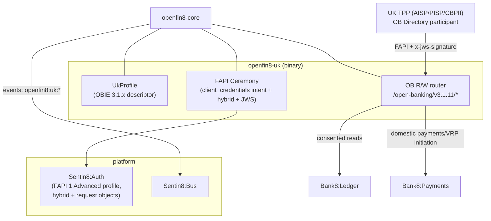
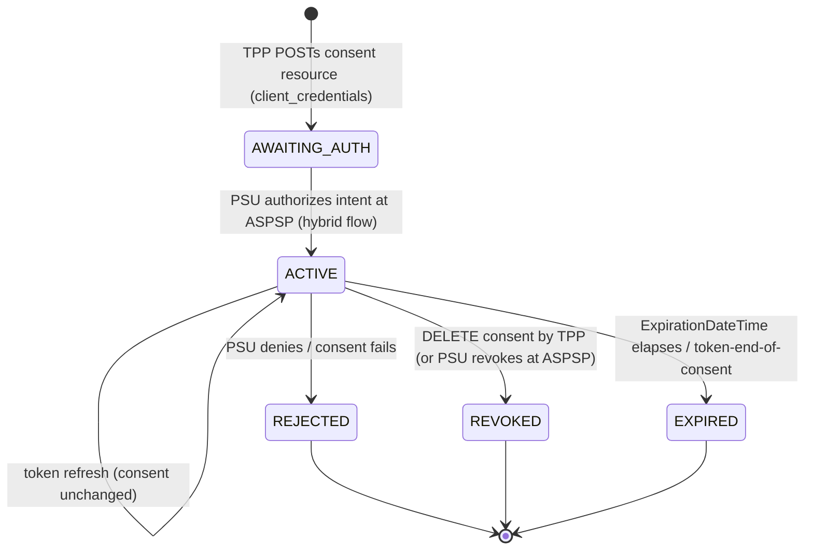

# openfin8-uk - Detailed Design Document

> Status: **PROPOSED** - the UK open-banking Account Servicing
> Payment Services Provider (ASPSP) service (OBARCH-5),
> implementing the Open Banking Limited (OBL) Read/Write API
> standard (v3.1.x line - 3.1.11 the initial target, v4.0.1 a
> configuration option). This is the first adapter with a non-FDX
> wire and the largest build of the four: new ceremony profile,
> new envelope, request signing, and an intent-based consent model.
> Depends on: `openfin8-core` (OBARCH-1). Read that document and
> `bank8-open-us.DESIGN.md` first for shared context.

## 1. Scope & Context

**What this service is.** The UK ASPSP surface (`service_type:
openfin8:uk`, binary `openfin8-uk`): consent-checked
account/transaction data, payment initiation, and confirmation of
funds over the OBL Read/Write API
paths (`/open-banking/v{maj}.{min}/{aisp|pisp|cbpii}/...`),
serving Account Information Service Providers (AISPs), Payment
Initiation Service Providers (PISPs), and Card-Based Payment
Instrument Issuers (CBPIIs) - the TPP roles. It embeds
`openfin8-core` and supplies the UK profile, the FAPI-ceremony
impl, and the OB wire router.

**What core already gives it.** The grant ledger (consent resources
map 1:1 to OB's per-Permission consents), the recipient registry
(the OB client-per-ASPSP DCR cache), CSDF (OB permissions are a
vocabulary over the same filter engine), the notification worker,
admin pages, audit, and Flow step profile - all per OBARCH-1.

**What is genuinely new here** (vs the US/CA adapters):

| Concern | UK delta | Weight |
|---|---|---|
| Consent model | Intent-based: TPP stages a consent resource via `client_credentials` grant; PSU authorizes the intent at the ASPSP; token bound to intent-id. Core's `awaiting_authorization` state + `intent_payload` column (OBARCH-1 §3) were designed for this | medium |
| Ceremony | FAPI 1 Advanced: hybrid flow (`code id_token`), request-object JWTs, PAR; **detached JWS request signing** (`x-jws-signature`, PS256, RFC 7515 Appendix F + RFC 7797) | large |
| Envelope | `{Data, Risk, Links, Meta}` response wrapping; conditional-field exclusion semantics; 400-vs-404 rules; pagination links | medium |
| Directory trust | OB Directory: TPP org-id/software-statement-id in JWS `iss`/`tan` claims; software statement assertions in DCR | medium |
| Payments | OB domestic payments (incl. VRP - variable recurring payments - consent + sweep), file payments (deferred), the `x-idempotency-key` discipline | medium |
| Event notification | OB Event Notification API (JWS-signed event payloads; `aggregated-polling` + webhook modes) layered on core's worker | small |
| Spec publication | **Vendored** - OBL specs are MIT Open Licensed; the UK swagger MAY be carried with the OBL notice (OBARCH-2) | small |

**Regulatory posture.** UK open banking is mandated (CMA order for
the CMA9 + PSD2/FCA rules for all ASPSPs): this service is the
compliance surface - availability targets, error semantics
(`400` for unknown resource ids, `200`-with-empty-array for no
standing orders, `404` only for unimplemented endpoints), and the
customer-experience obligations are all wire-level behaviors this
adapter must honor exactly.



## 2. The UK Profile

```rust
pub struct UkProfile {
    /// "3.1.11" | "4.0.1" from OPENFIN8_UK_VERSION (default "3.1.11").
    version: String,
}

impl OpenBankingProfile for UkProfile {
    fn jurisdiction(&self) -> &'static str { "uk" }
    fn standard(&self) -> StandardDescriptor {
        StandardDescriptor {
            name: "OBIE",
            version: self.version.clone(),
            license: StandardLicense::VendoredMitObl,
            families: &["AIS", "PIS", "CBPII", "VRP", "EVENTS"],
        }
    }
    fn provider_prefix(&self) -> String {
        // "/open-banking/v3.1.11" - note maj.min, unlike FDX's v{major}
        format!("/open-banking/v{}", ob_version_path(&self.version))
    }
    fn data_clusters(&self) -> &'static [DataClusterDef] {
        &OB_CLUSTERS   // OBPermissionsBasic/Detailed etc. as cluster defs
    }
    fn scope_to_clusters(&self, scope: &str) -> Vec<DataCluster> {
        ob_permission_map(scope)   // ReadAccountsBasic → ACCOUNTS_BASIC etc.
    }
    fn route_contract(&self) -> &'static [RouteDef] { &OB_ROUTES }
    fn envelope(&self) -> EnvelopeStyle {
        EnvelopeStyle::ObDataLinksMeta   // {Data, Risk, Links, Meta}
    }
    fn spec_publication(&self) -> SpecPublicationPolicy {
        SpecPublicationPolicy::VendoredMitObl   // OBL MIT open licence
    }
}
```

**Path structure** (OBL Read/Write Data API Profile):
`[participant-path-prefix]/open-banking/v{maj}.{min}/{aisp|pisp|cbpii}/{resource}`.
The role segment is a route dimension FDX doesn't have: the same
resource family mounts per role with role-specific consent
permission requirements. `OB_ROUTES` therefore carries a role
dimension on each `RouteDef` (extension to core's route contract -
see §8 open question on generalizing this).

## 3. The Consent Model (intent-based)

The core state machine (OBARCH-1 §3) covers the UK phases:



- **Staging**: `POST /aisp/account-access-consents` (AIS),
  `/pisp/domestic-payment-consents` (PIS),
  `/cbpii/funds-confirmation-consents` - called with a
  `client_credentials` access token (TPP identification only, no
  PSU). The consent body (permissions, expiration, transaction
  from/to) lands in core's `consents` row (`status
  awaiting_authorization`) with the OB consent resource serialized
  into `intent_payload`; the OB `ConsentId` IS the core consent id.
- **Authorization**: the TPP redirects the PSU to the ASPSP
  authorization endpoint with the intent id (PAR request object
  binds it - FAPI requires the hybrid flow with
  `response_type=code id_token`); Auth runs its consent RFW host
  ceremony (core's `/v1/auth/consent/*` screens with UK scope
  wording); on completion the grant event seeds core's ledger
  (`sentin8:auth:grant:created`, unchanged mechanism) and the
  consent moves `awaiting_authorization → active`.
- **Token binding**: the access token is issued bound to the
  intent (Auth's FAPI profile binds `openbanking-intent-id` into
  the request object); data calls present it and the middleware
  resolves consent by intent id - the same "consent check keys on
  the token" property as FDX, with intent-id as the join key.
- **Revocation**: `DELETE /aisp/account-access-consents/{id}` (TPP)
  or PSU revocation through the bank's channels - both land on
  core's revocation record; OB requires subsequent reads answer
  `400` for the dead consent (a wire behavior the adapter maps from
  core's terminal-revocation invariant).

**Recipient registry** (the TPP side, when the bank's fintech
customers act as TPPs): the core two-ledger model holds unchanged -
the recipient env keeps its per-ASPSP client registry; DCR carries
the software statement assertion (SSA) issued by the OB Directory.

## 4. Ceremony: FAPI 1 Advanced + JWS

Auth (Sentin8:Auth) gains a FAPI 1 Advanced profile flag per
consent provider; this adapter's `ConsentCeremony` impl drives it:

1. **Client registration (DCR)** - RFC 7591 with the OB SSA;
   redirect URIs + the software-statement claims verified against
   the Directory's JWKS.
2. **Intent staging** - `client_credentials` grant call to create
   the consent resource (§3).
3. **Authorization** - PAR (RFC 9126) with a request-object JWT:
   `aud` = the issuer, `response_type=code id_token` (hybrid - the
   id_token returns at the front channel binding the code),
   `openbanking-intent-id` claim carrying the consent id.
4. **Token exchange** - authorization-code + PKCE; the id_token is
   verified (its `nonce`/`c_hash` under FAPI), the access token is
  intent-bound.
5. **Request signing** - every consent/payment POST and every
   payment PUT carries `x-jws-signature`: detached PS256 JWS over
   the request body, JOSE header carrying `kid` (ASPSP signing
   key), `http://openbanking.org.uk/iss` (org-id/software-statement-id),
   `http://openbanking.org.uk/tan` (`openbanking.org.uk`),
   `http://openbanking.org.uk/iat`, and `crit` listing all three.
   The ASPSP verifies with the Directory-published JWKS.
   **Response signing** - the ASPSP signs responses the same way
   (mandatory for payment initiation responses).

**Trust anchors**: the OB Directory JWKS endpoints (production +
directory-testing) are fetched + cached at the ceremony ctx level;
key rotation follows the Directory's schedule. No ICP/ICP-Brasil
machinery (that is BR's), no DPoP (FAPI 1 Advanced uses mTLS or
private_key_jwt client auth + the hybrid flow - this deployment
uses `private_key_jwt` over the platform's TLS).

## 5. Wire Surface (resource families)

Mounted per role (`aisp`, `pisp`, `cbpii`) behind
`provider_middleware` with `OB_ROUTES` + the OB envelope codec:

| Family | Resources | Notes |
|---|---|---|
| **Account access consents** (aisp) | `POST/GET/DELETE account-access-consents`, `GET accounts`, `GET accounts/{id}`, `GET accounts/{id}/balances`, `/transactions`, `/beneficiaries`, `/direct-debits`, `/standing-orders`, `/statements` (+ `/statements/{id}/file` 302→Storage), `/scheduled-payments`, `/offers`, `/parties`, `/products` | permissions per OB `OBPermissions1`; balances/transactions honor `ReadTransactionsDebits/Credits` semantics via CSDF |
| **Domestic payments** (pisp) | `POST/GET domestic-payment-consents`, `POST/GET domestic-payments`, + `domestic-scheduled-payments`, `domestic-standing-orders` | `x-idempotency-key` mandatory on POST; risk payload passthrough |
| **VRP** (pisp) | `POST/GET domestic-vrp-consents`, `POST/GET domestic-vrps` (sweeping first; `vrp-basic` profile) | consent carries control parameters (max amount, periodic limits); execution enforced at Payments |
| **File payments** (pisp) | `POST file-payment-consents` + `/file` upload, `GET file-payments` | pain.001.001.09 batch - maps to Payments' payment-file pipeline |
| **Confirmation of funds** (cbpii) | `POST funds-confirmation-consents`, `POST funds-confirmations` | CBPII role; funds check against Ledger balances |
| **Event notification** | `POST /event-notifications` (webhook mode), `GET event-notifications/{...}` (aggregated polling) | JWS-signed payloads emitted from core's notify worker |

**Envelope codec** (`EnvelopeStyle::ObDataLinksMeta`): responses
wrap in `{Data, Risk, Links, Meta}` with absolute `Links.Self`
(pagination links for list resources, `Meta.TotalPages`); requests
unwrap `Data`/`Risk` before the handler sees them. Conditional
fields are **excluded** (never empty-string/zero) and `0..*`
arrays are present-but-empty - both enforced in the codec.

**Error semantics** (OBL): unknown resource id → `400`; resource
defined-but-unimplemented → `404`; empty list → `200` with empty
array; the `OBErrorResponse1` shape (`{Errors:[{ErrorCode, Message,
Path, Url}]}` with OB error codes like `UK.OBIE.Field.Missing`) is
the adapter's error renderer, mapped from core's `FdxError`-style
kernel errors (the kernel error type generalizes to
`OpenApiError` in core).

**Discovery**: OB has no capability endpoint equivalent; the
ASPSP's `/.well-known/openid-configuration` (Auth's) is the
discovery surface. Core's discovery pages render the served version
+ role matrix for admin.

## 6. Registration & Configuration

- `service-registration.json`: service_type `openfin8:uk`,
  subdomain `openfin8-uk`; Shield gates `openfin8:uk:*`
  (role-scoped: `openfin8:uk:aisp:*` etc. where the wire role
  implies the gate).
- `catalog.json`: binary `openfin8-uk`, database env var
  `OPENFIN8_UK_DATABASE_URL`.
- Env: `OPENFIN8_UK_PORT`, `OPENFIN8_UK_DATABASE_URL`,
  `OPENFIN8_UK_BASE_URL`, `OPENFIN8_UK_VERSION` (default
  `3.1.11`), `OPENFIN8_UK_DIRECTORY_JWKS_URL` (OB Directory),
  `OPENFIN8_UK_SIGNING_KEY_REF` (ASPSP signing key -
  `sentin8-secrets://` reference, PS256), plus the platform
  standard set; per-env overrides via `sys.services.config`.

## 7. Spec Publication (OBARCH-2) - the vendored case

`SpecPublicationPolicy::VendoredMitObl`: OBL publishes the R/W API
specifications under the MIT Open Licence (openbanking.org.uk
open-licence) - the UK adapter MAY carry the standard's paths in
its published `docs/openapi.json` **with the OBL copyright notice
preserved** (the MIT notice travels with any copied swagger). The
published spec is therefore complete for UK TPPs: bank8-owned
surfaces plus the OB resource paths. The drift guard asserts the
OBL notice is present in the spec's license/info block and that the
OB paths conform to the versioned prefix. The OB swagger files
themselves are NOT committed verbatim (they are large and versioned
externally); the published spec is the utoipa aggregate with the
MIT notice - see §8 open question on vendoring the upstream YAMLs
under `specs/ob/{version}/` for reference instead.

## 8. Invariants, Failure Modes, Testing

- All core invariants hold (consent chokepoint, terminal revocation,
  secret refs, tenant discipline, no `unsafe`, profile isolation).
- **New UK invariants**: every payment initiation verifies the
  `x-jws-signature` and signs its response; every consent creation
  runs on `client_credentials` (never a PSU token); the
  intent-id-to-token binding is verified at the middleware (a token
  may only read the intent it was issued against); VRP executions
  enforce the consent's control parameters at initiation time.
- **Failure modes**: Directory JWKS unreachable → request signing
  verification fails closed (503, never skip-verify); signing key
  rotated → reference swap in Secrets, dual-kid overlap window; PSU
  abandons ceremony → consent stays `awaiting_authorization`, OB
  requires expiry of staged intents after 24h (a core lifecycle
  sweep - see open questions).
- **Testing**: ceremony tests against Auth's FAPI profile (hybrid +
  request objects) on a scratch org; envelope codec round-trips
  (conditional exclusion, empty-array, pagination links); error
  semantics (400-vs-404 fixtures per the OBL profile); JWS
  sign/verify with a test Directory JWKS; the e2e recipient journey
  gains the UK AISP flow (consent → authorize → accounts/transactions)
  and the PISP domestic payment flow in `bank8-e2e`.

## 9. Open Questions

- **RouteDef role dimension** - core's route contract gains a
  `role: Option<&str>` field (UK-only for now) vs a
  `RouteDef::Role(...)` variant. Leaning the field: it stays
  `None` for FDX and the middleware consults it for the role-segment
  match.
- **Staged-intent expiry sweep** - OB's 24h intent retention rule
  needs a lifecycle job (Cron registration) sweeping
  `awaiting_authorization` rows; whether that lands in core (all
  profiles) or the UK adapter's registration schedules (this
  service only) - leaning UK adapter first, core when BR/XS2A need
  the same rule.
- **Directory connectivity in dev** - the OB Directory testing
  environment requires participant onboarding; whether the dev/e2e
  stack runs against a **mock Directory** (a fixture JWKS + SSA
  issuer in `bank8-e2e` fixtures) - leaning yes, with a
  `OPENFIN8_UK_DIRECTORY_MODE=mock|real` env switch.
- **VRP non-sweeping (`vrp-extended`)** - out of scope for the
  initial adapter; the consent table's `intent_payload` carries the
  control parameters either way, so the extension is additive.
- **OBL conformance suite** - running the official OB conformance
  tooling against the adapter is the certification path for UK
  ASPSPs; where that runs (CI nightly vs pre-release manual) is an
  operational decision left open.

---

**Architecture & Design:** openfin8:uk and its underlying concepts were
designed by [Hamid Jahanzad](https://www.linkedin.com/in/hamidjahanzad/).