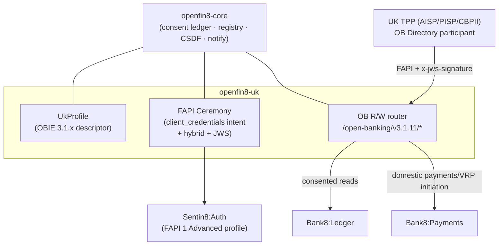

# OpenFin8:UK - README

[](https://github.com/OpenFin8/openfin8-uk/blob/main/LICENSE)
[](https://www.rust-lang.org/)
[](https://bank8.dev/docs/services/open-uk)
[](https://bank8.dev)

UK open banking (OBL Read/Write API v3.1.x/v4.0.1): the ASPSP
surface serving Account Information Service Providers, Payment
Initiation Service Providers, and Card-Based Payment Instrument
Issuers - consent-checked account data, payment initiation, and
confirmation of funds over
`/open-banking/v{maj}.{min}/{aisp|pisp|cbpii}/*`.

## Summary

OpenFin8:UK is a Rust service that plays the **ASPSP** role for
the UK market: it stages consent resources (account-access,
domestic-payment, VRP, funds-confirmation consents) for TPPs over
the OBL Read/Write API, runs the PSU authorization ceremony through
the platform-hosted consent screens, serves consented account/
transaction/statement data with CSDF data minimization, initiates
domestic payments (incl. variable recurring payments), and confirms
funds for CBPIIs - honoring the OBL wire contract exactly
(`{Data, Links, Meta}` envelopes, 400-vs-404 semantics,
`x-idempotency-key`, detached JWS request/response signing).

The service embeds [`openfin8-core`](https://github.com/OpenFin8/openfin8-core) - the
jurisdiction-agnostic kernel - and supplies the UK OBIE
profile, the FAPI 1 Advanced ceremony (client_credentials intent
staging, hybrid flow with request objects binding the
`openbanking-intent-id`, PS256 detached JWS with the OB Directory
JOSE claims), and the OB resource router. The US and Canadian
adapters ([`bank8-open-us`](https://github.com/OpenFin8/openfin8-us),
[`bank8-open-ca`](https://github.com/OpenFin8/openfin8-ca)) follow the same contract.

**Licensing posture**: the Open Banking Standard is published by
Open Banking Limited under the MIT Open Licence - unlike the FDX
adapters, this repository MAY vendor the OB resource paths in its
published `docs/openapi.json`, with the OBL copyright notice
preserved (enforced by a CI drift guard).

## Motivation

UK open banking is mandated (CMA order + PSD2/FCA rules): this
service is the compliance surface. Availability targets, error
semantics, and customer-experience obligations are all wire-level
behaviors this adapter must honor exactly - and the intent-based
consent model (TPP stages a consent via `client_credentials`; the
PSU authorizes the intent; the token is bound to it) is materially
different from the FDX consent-object flow, which is why it rides
the shared kernel through core's `awaiting_authorization` state and
`intent_payload` column rather than forking the ledger.

## Architecture & High-Level Design



Read [`DESIGN.md`](https://github.com/OpenFin8/openfin8-uk/blob/main/DESIGN.md) for the full design: the
intent consent state machine, the FAPI ceremony steps, the envelope
codec rules, the JWS signing profile, and the OB Directory trust
integration.

## The served surface

- the **intent-based consent model** (`src/consent.rs`) - the
  client-credentials staging into `intent_payload`, the OB four-state
  machine (`AwaitingAuthorisation`/`Authorised`/`Rejected`/`Consumed`
  + terminal `Revoked`), the authorization observation path, the
  revocation→400 OBL rule, and the 24h staged-intent expiry sweep
  (the declared cron schedule);
- the **FAPI 1 Advanced ceremony + detached JWS signing**
  (`src/ceremony.rs`) - the OB Directory `crit`/`iss`/`tan`/`iat`
  JOSE-header validation, the fail-closed verdicts (the Directory down
  → 503, never skip-verify), the DCR body with the software-statement
  assertion, and the hybrid request-object shape binding the
  `openbanking-intent-id`;
- the **OB envelope codec + error model** (`src/envelope.rs`) - the
  `{Data, Risk, Links, Meta}` wrapping with absolute self-links +
  conditional pagination, the request unwrapping, the
  conditional-field exclusion (never null-rendered; empty arrays
  stay), `OBErrorResponse1` with the `UK.OBIE.*` vocabulary, and the
  OBL error rules (unknown id → 400; defined-but-unimplemented →
  404; empty lists → 200-with-empty-array);
- the **aisp surfaces** (`src/aisp.rs`) - the account/sub-resource
  reads behind the intent-bound permission chokepoint (the Ledger
  proxy lane, OBVERT), the statement file redirect, and the honest
  404s for the unserved sub-resources;
- the **pisp surfaces + VRP** (`src/pisp.rs`) - the domestic-payment
  and VRP consent staging (the control parameters persisted on the
  consent), the payment submissions with the `x-idempotency-key`
  discipline and the JWS gate, the **VRP control-parameter
  enforcement at initiation time**, and the honest file-payments 404;
- the **cbpii surfaces + the OBL event notifications** (`src/cbpii.rs`)
  - the funds-confirmation consent + check (the Ledger balance
  verdict), and the webhook + aggregated-polling event routes;
- the **e2e journey** (`openfin8-e2e`:
  `openfin8_uk_ob_journey.spec.ts`) - the intent staging, the
  envelope assertions, the revocation→400 verdict, the JWS +
  idempotency gates, and the honest 404s;
- the **published spec + drift guard** - the vendored OBL-notice
  spec (17 ops under `/open-banking/v3.1/*`), the router↔spec drift
  guard both directions, and the site's UK dossier (the product
  pages + the API tree).

The schema is `openfin8_uk` (the intent-staged consents + the VRP
control parameters + the recipient registry + the provider catalog;
FORCE-RLS env-pinned). The deferred surfaces: the browser-driven FAPI
PSU authorization page (the recipient-app story), the resolved
signing-key material (the production PS256 path over the dev
fixture), the real OB Directory JWKS fetch (the dev fixture stands
in), and the file-payments family.

## Development

```bash
make help     # the available targets
make build    # cargo build
make test     # cargo test
make lint     # cargo fmt -check
make start    # infra + trimmed boot if captain is down
make status   # fleet rows for openfin8:uk
make enroll   # register this repo (composable enrollment, RS §6)
```

## Contributing & License

Apache-2.0 (see [LICENSE](https://github.com/OpenFin8/openfin8-uk/blob/main/LICENSE), [NOTICE](https://github.com/OpenFin8/openfin8-uk/blob/main/NOTICE)). The security
model is platform-wide - read [SECURITY.md](https://github.com/OpenFin8/openfin8-uk/blob/main/SECURITY.md). Portions
of the Open Banking Standard referenced by the published spec are
used under the OBL MIT Open Licence.

---

**Architecture & Design:** openfin8:uk and its underlying concepts
were designed by [Hamid Jahanzad](https://www.linkedin.com/in/hamidjahanzad/).