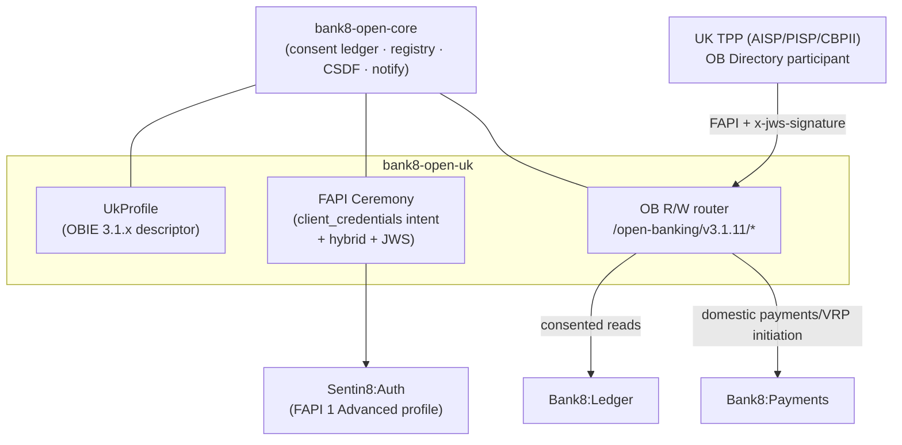

# Bank8:OpenUK - README

[](LICENSE)
[](https://www.rust-lang.org/)
[](https://bank8.dev/docs/services/open-uk)
[](https://bank8.dev)

UK open banking (OBL Read/Write API v3.1.x/v4.0.1): the ASPSP
surface serving Account Information Service Providers, Payment
Initiation Service Providers, and Card-Based Payment Instrument
Issuers - consent-checked account data, payment initiation, and
confirmation of funds over
`/open-banking/v{maj}.{min}/{aisp|pisp|cbpii}/*`.

## Summary

Bank8:OpenUK is a Rust service that plays the **ASPSP** role for
the UK market: it stages consent resources (account-access,
domestic-payment, VRP, funds-confirmation consents) for TPPs over
the OBL Read/Write API, runs the PSU authorization ceremony through
the platform-hosted consent screens, serves consented account/
transaction/statement data with CSDF data minimization, initiates
domestic payments (incl. variable recurring payments), and confirms
funds for CBPIIs - honoring the OBL wire contract exactly
(`{Data, Links, Meta}` envelopes, 400-vs-404 semantics,
`x-idempotency-key`, detached JWS request/response signing).

The service embeds [`bank8-open-core`](../bank8-open-core) - the
jurisdiction-agnostic kernel (OBARCH-1) - and supplies the UK OBIE
profile, the FAPI 1 Advanced ceremony (client_credentials intent
staging, hybrid flow with request objects binding the
`openbanking-intent-id`, PS256 detached JWS with the OB Directory
JOSE claims), and the OB resource router. The US and Canadian
adapters ([`bank8-open-us`](../bank8-open-us),
[`bank8-open-ca`](../bank8-open-ca)) follow the same contract.

**Licensing posture**: the Open Banking Standard is published by
Open Banking Limited under the MIT Open Licence - unlike the FDX
adapters, this repository MAY vendor the OB resource paths in its
published `docs/openapi.json`, with the OBL copyright notice
preserved (enforced by a CI drift guard).

## Motivation

UK open banking is mandated (CMA order + PSD2/FCA rules): this
service is the compliance surface. Availability targets, error
semantics, and customer-experience obligations are all wire-level
behaviors this adapter must honor exactly - and the intent-based
consent model (TPP stages a consent via `client_credentials`; the
PSU authorizes the intent; the token is bound to it) is materially
different from the FDX consent-object flow, which is why it rides
the shared kernel through core's `awaiting_authorization` state and
`intent_payload` column rather than forking the ledger.

## Architecture & High-Level Design



Read [`DESIGN.md`](DESIGN.md) (OBARCH-5) for the full design: the
intent consent state machine, the FAPI ceremony steps, the envelope
codec rules, the JWS signing profile, and the OB Directory trust
integration.

## Status

**Skeleton** - the trait-shaped binary boots on the sentin8 shell
with a stub registration; the OBARCH-1 core extraction lands first,
then the UK wire, ceremony, and registration follow.

## Development

```bash
make help     # the available targets
make build    # cargo build
make test     # cargo test
make lint     # cargo fmt -- --check
make start    # infra + trimmed boot if captain is down
make status   # fleet rows for bank8:open-uk
make enroll   # register this repo (composable enrollment, RS §6)
```

## Contributing & License

Apache-2.0 (see [LICENSE](LICENSE), [NOTICE](NOTICE)). The security
model is platform-wide - read [SECURITY.md](SECURITY.md). Portions
of the Open Banking Standard referenced by the published spec are
used under the OBL MIT Open Licence.

---

**Architecture & Design:** bank8:open-uk and its underlying concepts
were designed by [Hamid Jahanzad](https://www.linkedin.com/in/hamidjahanzad/).